# `feat/kokkos-wind-mapping`: structure-manipulating transformations added relative to `master`

## Question

> In this branch, which additions from master are transformations which
> manipulate code structure? i.e. inlining

## How this was answered

- Compared `origin/feat/kokkos-wind-mapping` with local `master` using the
  three-dot diff (`git diff master...origin/feat/kokkos-wind-mapping`). That
  shows only what the branch changed since it diverged.
- Merge base: `bee88804a8`. The branch is **256 commits** ahead of it and
  touches 129 files (about +50.7k / -0.6k lines).
- Local `master` is older than `upstream/master`, so "added relative to
  master" means relative to the point where the branch forked.
- Everything below comes from reading the source on the branch with
  `git show`. I did **not** check out the branch, run the tests or run any
  generated code.

## Short answer

The branch adds **one new `Transformation` subclass**,
`LFRicKokkosTrans`. It is the only class that subclasses `Transformation`
among the new files in `src/psyclone/domain/lfric/transformations/`.

It does not do its work itself. Behind it are 18 mixins (about 9,700 lines),
and `apply()` calls these helpers to rewrite the kernel's PSyIR, mostly in
place. Those helpers are:

- **Inlining** is the main one: `_inline_calls`, which wraps the existing
  `InlineTrans` and `KernelModuleInlineTrans`.
- Several smaller rewrites run after it: hoisting folds and array
  expressions into temporaries, lowering `ALLOCATE`, lowering array
  assignments to loops, and constant folding.
- Finally it replaces the original `LFRicLoop` with a `Call`.

The branch also **modifies three existing transformations**
(`InlineTrans`, `KernelModuleInlineTrans`, `ProfileTrans`). These are
bug-fixes and precision changes, not new transformations.

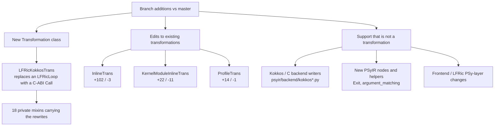

## 1. The new transformation: `LFRicKokkosTrans`

File: `src/psyclone/domain/lfric/transformations/lfric_kokkos_trans.py`
(exported from the package `__init__.py`).

It replaces one supported LFRic loop (a cell-column loop, coloured or not, or
a dof loop) with a call through a `bind(C)` interface. It also generates the
Kokkos C++ for the loop body and returns it as a string.

`validate()` predicts what `apply()` will do **on copies** of the kernel
schedule, so the real schedule is untouched. `apply()` then runs the same
rewrites on the real schedule, in this order:

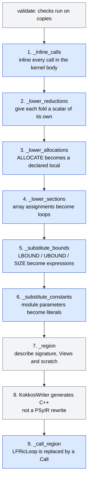

Blue boxes are tree rewrites. Grey boxes are checking, describing or code
generation.

### Structure-manipulating rewrites

| # | Rewrite | Mixin / method | What it does to the tree |
|---|---------|----------------|--------------------------|
| 1 | **Call inlining** | `LFRicKokkosBoundMixin._inline_calls`, `LFRicKokkosInlineMixin._inline_one` | Repeatedly finds calls in the kernel body and inlines them with `InlineTrans().apply(call)`. A pass inlines one call, then the body is re-walked because inlined bodies bring new calls. A refusal caused by a declaration depending on a written argument is deferred while other calls are pending. It is capped by `_INLINE_LIMIT` as a recursion guard. |
| 1a | Module inlining of the callee | `LFRicKokkosInlineMixin._module_inline`, `_absorb_own_module_calls` | Uses `KernelModuleInlineTrans().apply(call)` to bring the callee into the caller's Container first. It also inlines sibling-routine calls inside the callee. |
| 1b | Callee preparation before inlining | `_relax_target_arguments`, `_relax_protected_actuals`, `LFRicKokkosAliasMixin._alias_locals`, `LFRicKokkosImportMixin` (`_carry_module_names`, `_localise_imports`, `_agree_on_imports`, `_alias_clashing_imports`), `LFRicKokkosElementMixin._section_element_actuals`, `LFRicKokkosBoundMixin._bound_locals` | Edits symbols, declarations and imports so that `InlineTrans` accepts the routine. Examples: drop `TARGET`/`PROTECTED` attributes, re-type `POINTER` aliases, resolve import clashes, wrap element actuals as one-element sections, size locals from a caller-asserted bound. |
| 1c | Hoisting array actuals into temporaries | `LFRicKokkosTemporaryMixin._hoist_array_expressions`, `_hoist_constructors`, `_hoist_intrinsic_operands` | Inserts `tmp = <array expr>` before the statement and replaces the actual with `tmp`. |
| 2 | **Fold hoisting** | `LFRicKokkosIntrinsicMixin._lower_reductions` / `_hoist_fold` | Moves a `SUM`/`MAXVAL`-style fold that sits inside a larger expression into its own assignment just before the statement. It refuses when the fold is in a `DO WHILE` condition. |
| 3 | **ALLOCATE lowering** | `LFRicKokkosIntrinsicMixin._lower_allocations` | Rewrites the local's declaration with the `ALLOCATE` shape and detaches the `ALLOCATE`/`DEALLOCATE` calls. |
| 4 | **Array section lowering** | `LFRicKokkosScheduleMixin._lower_sections` | Applies `Reference2ArrayRangeTrans` and `ArrayAssignment2LoopsTrans`, turning `a(:) = b(:)+c` into explicit loops. |
| 5 | **Shape-enquiry substitution** | `LFRicKokkosBoundsMixin._substitute_bounds`, `_resolve_assumed_shapes`, `LFRicKokkosArgumentMixin._rename_extents` | Replaces `LBOUND`/`UBOUND`/`SIZE` with a copy of the declared bound's PSyIR. Assumed-shape formals get implicit extent scalars. Per-cell array bounds are rewritten around per-cell sizes. |
| 6 | **Constant substitution** | `LFRicKokkosConstantsMixin._substitute_constants` | Replaces each reference to a module-level `parameter` with the value it was declared with. |
| 7 | **Built-in schedule synthesis** | `LFRicKokkosBuiltinMixin._builtin_schedule` | For an LFRic built-in, which has no kernel file, builds a schedule by calling `lower_to_language_level()` on a copy. |
| 8 | **Loop to call replacement** | `LFRicKokkosArgumentMixin._call_region`, `_lower_halo_exchanges` | Replaces the `LFRicLoop` with the typed `Call` into the generated region. It also lowers `HaloExchange` nodes in the invoke with `lower_to_language_level()`. |

### Mixins that do not change structure

These mixins only check, describe or classify. They are listed so it is clear
what was left out of the table above.

| Mixin | Role |
|-------|------|
| `LFRicKokkosContractMixin` | Side-effect-free `_validate_*` predicates (the "capture contract") |
| `LFRicKokkosTypesMixin` | Maps LFRic kinds to C types |
| `LFRicKokkosIterationMixin` | Checks the iteration space and names the launch bounds |
| `LFRicKokkosWriteMixin` | Decides whether a shared write is safe, via atomics or disjoint writes |
| `LFRicKokkosInterfaceMixin` | Writes the `bind(C)` interface and kind-width assertions |
| `LFRicKokkosCallMixin` | Describes team scratch and PSy-layer imports for the call site |

A few mixins mix both roles. The Argument mixin, for example, builds the
region description (`_region`) and also rewrites the tree (`_call_region`,
`_rename_extents`).

## 2. Edits to existing transformations

None of these adds a new transformation. They make existing ones more
accurate or safer, which is what lets `LFRicKokkosTrans` inline real LFRic
kernels.

| File | Change |
|------|--------|
| `psyir/transformations/inline_trans.py` | New `_call_may_write()`. An opaque call that cannot reach a local variable no longer blocks inlining on the "declaration depends on an argument that may be written" check. `validate()` now pre-checks symbol-table clashes on a copy, so a clash is a `TransformationError` rather than a later `InternalError`. The debug string is built only when it is needed, because the commit comment says it was most of the time spent inlining a kernel with about thirty helper calls. |
| `domain/common/transformations/kernel_module_inline_trans.py` | When a generic interface is brought in, the code now creates a **new** `GenericInterfaceSymbol` for the caller's Container instead of mutating the source module's symbol. That module tree is shared via the `ModuleManager`. It also re-points `Call`s that still referred to the removed import. |
| `psyir/transformations/profile_trans.py` | Refuses regions containing an `Exit` node. This is needed because the branch makes `EXIT` a first-class node. |

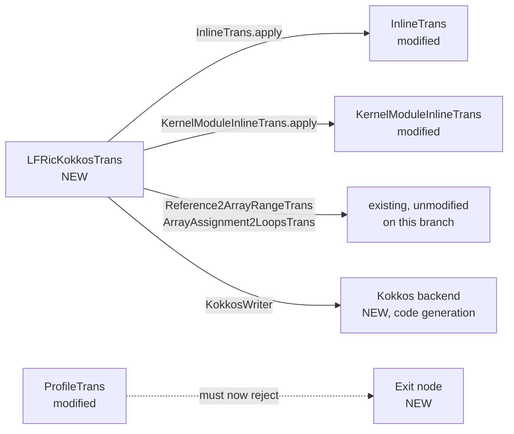

## 3. Related additions that are not transformations

These changes support the transformation but do not manipulate code
structure as transformations. I read their file lists and headers, but I did
not audit each backend writer for tree mutation.

- **Backend writers** (`psyir/backend/kokkos*.py`, `c_*.py`): they generate
  C/C++ from PSyIR. This is code generation, not a PSyIR-to-PSyIR rewrite.
- **`psyir/nodes/exit_stmt.py`** (`Exit`): a new node. The frontend
  (`fparser2.py`) now produces it instead of a `CodeBlock`.
- **`psyir/nodes/argument_matching.py`** (about 570 lines): argument-matching
  logic factored out of `Call`. `call.py` was reworked.
- **`lfric.py`, `lfric_invoke.py`, `lfric_loop*.py`, `kernel_interface.py`**:
  LFRic PSy-layer changes, such as PSy-layer symbol creation ahead of code
  generation and loop-bound handling, so the replacement call can be built.
- **`definition_use_chains.py`, `sympy_reader.py`, `reference.py`, `symbol.py`**:
  small supporting edits.

---

# Part 2: follow-up questions

## Follow-up questions

> 1. Which transformations and changes are for language translation, i.e.
>    Fortran to C++?
> 2. Which changes are generating Kokkos?
> 3. Which changes are managing data movement between memory spaces, either
>    CPU to GPU or GPU to GPU?
> 4. Are there NVIDIA-specific optimisations, like MPS?
> 6. Any changes linked to the number of levels and in-cell data alignment in
>    the kernel?
> 7. A brief section on any other major things the changes do.

The questions were numbered 1-4, 6, 7 (there was no 5). The numbering is kept
so the answers can be matched back to them.

**How these were answered.** Same method as Part 1: `git grep` and `git show`
on `origin/feat/kokkos-wind-mapping`, with no checkout and nothing run. In
addition, I read the two long guides the branch adds
(`doc/developer_guide/psyir_frontends_backends.rst`, +1.6k lines, and
`doc/user_guide/lfric.rst`, +1.7k lines), because they explain the *why* of
the Kokkos back-end in detail. **Performance figures and "N regions captured"
counts quoted below come from those docs. I did not reproduce any of them.**

The four things the whole branch does, which the sections below slice in
different ways:

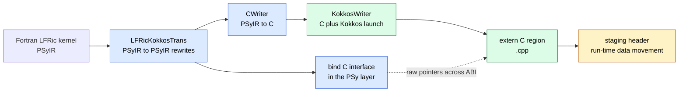

Blue is Q1 (translation), green is Q2 (Kokkos generation), amber is Q3 (data
movement). Q4 and Q6 cut across the green and amber parts.

## 4. Language translation, Fortran to C++ (question 1)

Translation happens in **four layers**. Only the first is a
`Transformation`. The other three are back-ends and ABI code, so they are not
"transformations" in PSyclone's sense, but they are where the language
actually changes.

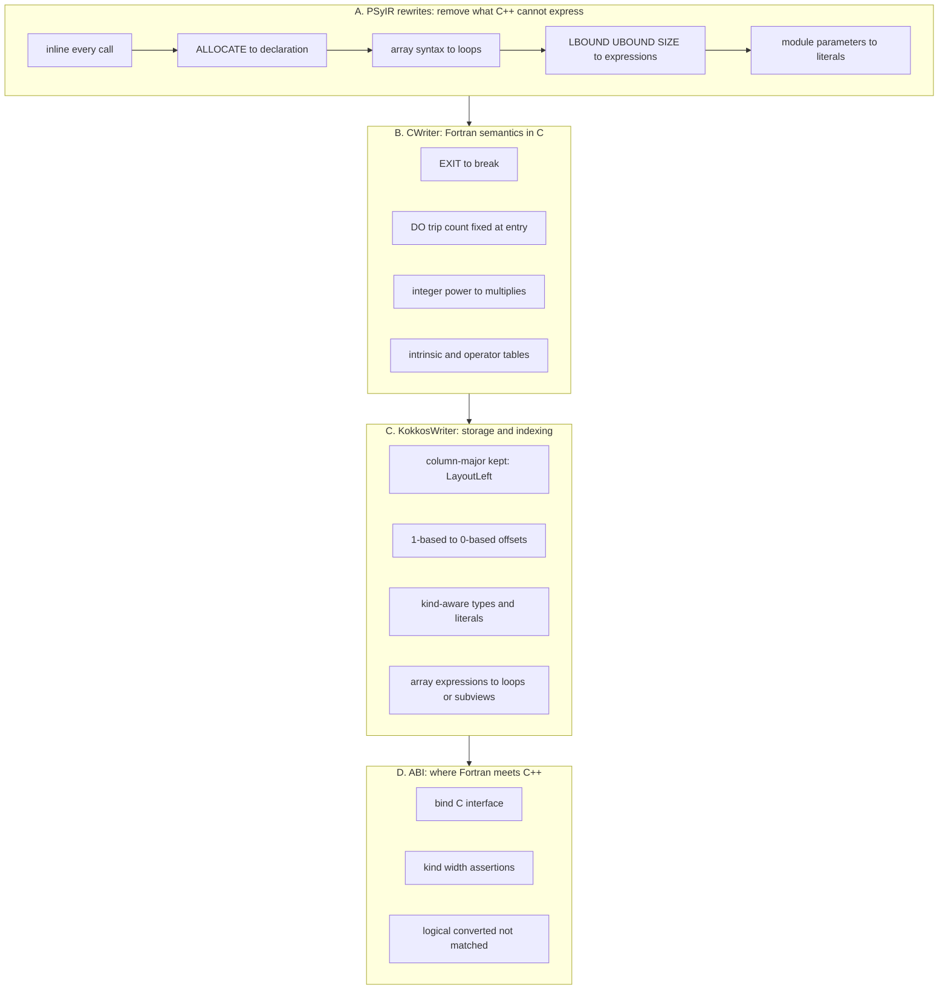

### A. PSyIR rewrites that make the kernel translatable

These are the rewrites from section 1, read for *why* they exist. The target
language has no equivalent of the Fortran construct, so it is removed
**before** any text is generated.

| Fortran feature | Rewrite | Where |
|-----------------|---------|-------|
| Calls into other routines or modules (the region is one C++ function) | `InlineTrans` / `KernelModuleInlineTrans`, repeated until no call is left | `_inline_calls`, `_inline_one`, `_module_inline` |
| `USE` imports, renamed imports, wildcard imports, generic interfaces | Resolve and localise names so inlining is accepted; a name the import would supply is resolved first | `LFRicKokkosImportMixin` |
| `TARGET`, `PROTECTED` attributes and `POINTER` aliases | Drop or re-type so the inliner accepts them; pointer aliases become View handles (see Q2) | `_relax_target_arguments`, `_relax_protected_actuals`, `_alias_locals` |
| `ALLOCATE` / `DEALLOCATE` of a local | Shape read from the `ALLOCATE`, declaration rewritten, both statements removed | `_lower_allocations` |
| Array syntax `a(:) = b(:) + c`, whole-array assignment | `Reference2ArrayRangeTrans` + `ArrayAssignment2LoopsTrans` | `_lower_sections` |
| `SUM`, `MAXVAL` and similar folds inside larger expressions | Moved into their own assignment | `_lower_reductions` |
| `LBOUND`, `UBOUND`, `SIZE`, assumed-shape formals | Replaced by the declared bound's expression; assumed-shape formals get extent scalars | `_substitute_bounds`, `_resolve_assumed_shapes` |
| Module `parameter`s | Replaced by their value (or carried as a constant when not a literal) | `_substitute_constants` |
| Array actuals passed to a callee | Hoisted into a temporary first | `LFRicKokkosTemporaryMixin` |
| LFRic built-ins (no kernel file) | Schedule synthesised from PSyclone's own lowering | `LFRicKokkosBuiltinMixin` |
| `EXIT` inside a loop | **Frontend:** `fparser2` now builds a first-class `Exit` node instead of a `CodeBlock`, so the C back-end can translate it | `psyir/nodes/exit_stmt.py`, `fparser2.py` |

### B. C back-end changes (`psyir/backend/c.py`, +578/-, plus two new modules)

`CWriter` already existed on `master` as a partial back-end. The branch makes
it translate the Fortran semantics that a naive text translation gets wrong:

- **`EXIT`** is written by `exit_node`, and **`DO WHILE`** by `whileloop_node`.
  The while condition is deliberately left where it is, because Fortran also
  re-evaluates it on every trip.
- **`DO` loop trip count.** Fortran fixes a `DO` loop's trip count when the
  loop is entered, and a C `for` header re-evaluates its bound every
  iteration. `_hoisted_bounds` / `_is_fixed_at_entry` therefore copy a stop or
  step that reads memory into a `const` local before the loop. A literal or an
  unwritten scalar is left alone, so the common `nlayers - 1` is unchanged.
- **Counting down.** `_loop_counts_down` makes `do k = n, 1, -1` become
  `for(k=n; k>=1; k+=-1)`.
- **Array constructors** (`arrayconstructor_node`) are written only where they
  fill an array.
- **Integer powers.** `c_integer_power.py` (new, +174) writes `x ** 2` as
  `(x * x)`, the multiplication tree gfortran produces, instead of `pow`.
- **Operator and intrinsic tables** moved into `c_intrinsics_mixin.py` (new,
  +486), with type-dependent handling (for example integer `MAX`/`MIN`).

### C. Kokkos back-end: the storage and indexing translation

`KokkosWriter` (`psyir/backend/kokkos.py` and its mixins) handles the parts of
the translation that depend on how Fortran lays out and indexes data:

- **Storage order.** Every array becomes a `Kokkos::LayoutLeft` View, which
  keeps Fortran's column-major order (leading dimension fastest), so a
  Fortran subscript list maps one-to-one onto a View access.
- **Lower bounds.** Fortran `dimension(0:nlayers)` is described by an extent
  and an `index_offsets` entry, and the offset is written even when zero
  (`u_e(k - 0)`) so there is no special case where a missing subtraction would
  be a silent wrong answer.
- **Cell index.** LFRic's one-based `cell` is declared as
  `const int cell = cell_1 + 1;` from the zero-based launch index.
- **Per-cell scalars.** A kernel formal such as `smap_size` that the PSy layer
  fills per cell is rewritten to `smap_size(cell)` in the body.
- **Kinds.** `kind_types` makes locals and literals the width of their own
  kind, so a single-precision kernel is not promoted to `double` by the C
  writer's default.
- **Array-valued expressions and intrinsics**
  (`kokkos_array_expression*.py`, `kokkos_array_intrinsics.py`, about 2.2k
  lines): written as generated loops, as a `Kokkos::subview` where a slice is
  contiguous in `LayoutLeft`, or as a copy where it is not.
- **Kokkos-spelled intrinsics** (`kokkos_intrinsics_mixin.py`), for example
  `Kokkos::abs` and `Kokkos::max`, so the same text compiles for device code.
  `EPSILON` is written as the Kokkos numeric trait for its argument's kind
  (this is the "spelt so device code can pass it by reference" fix).

### D. The ABI where Fortran meets C++

- The region is an `extern "C"` function, and the PSy layer reaches it
  through a `bind(C)` interface (`LFRicKokkosInterfaceMixin`).
- `LFRicKokkosTypesMixin` maps each LFRic kind to a C type using LFRic's own
  precision map, so `r_solver` is single or double precision depending on how
  LFRic was configured.
- **Width assertions.** For each kind, the interface declares a `parameter`
  whose kind is a `merge` over a `storage_size` comparison, so a mismatch is a
  Fortran compile error with no generated code needed.
- **`logical`** is converted rather than matched: the dummy is
  `logical(c_bool), value` and the actual is wrapped in `LOGICAL(..., c_bool)`.
  It is the one type with no width assertion (LFRic's `l_def` is 4 bytes where
  PSyclone's map records 1, issue #1941).
- `kernel_interface.py` (+188) carries more argument shapes across the ABI:
  quadrature, evaluator basis, inter-grid, stencils, integer fields.
- Names Fortran allows but C++ reserves (`const`, `new`, `operator`) are
  refused (`LFRicKokkosContractMixin`).

## 5. Kokkos generation (question 2)

Two halves, split cleanly: **the transformation decides, the back-end
renders.** `LFRicKokkosTrans` works out *what the region is* (arguments,
roles, which loops to spread, which arrays go in scratch, how shared writes
are made safe) and hands the back-end a `KokkosRegion` description. The
back-end only checks it and writes text. The back-end refuses a description
that breaks its rules (`KokkosValidationMixin`), and says in its docs that
this means the transformation's own validation was too weak.

| Piece | Role in generating Kokkos |
|-------|---------------------------|
| `psyir/backend/kokkos.py` (577) | `KokkosWriter`: builds the whole translation unit, the `extern "C"` entry, the View declarations, `Kokkos::fence()` |
| `kokkos_region.py` (544) | The `KokkosRegion`, `KokkosView`, `KokkosScalar`, `KokkosScratch`, `KokkosColourMap` description objects |
| `kokkos_launch.py` (859), `kokkos_launch_dof.py` (128) | One function per launch shape, plus scratch sizing and placement |
| `kokkos_team_scalars.py` (395) | Decides which scalars are private to a team member (flow analysis) |
| `kokkos_spread_extent.py` (144) | Reads how far the spread loops run, to size the team |
| `kokkos_validation_mixin.py` (602) | Refuses malformed region descriptions before any text is generated |
| `lfric_kokkos_iteration_mixin.py`, `_write_mixin.py`, `_call_mixin.py`, `_argument_mixin.py` | Transformation side: iteration space, shared-write answer, scratch, argument roles |

### Launch shape, chosen by what the region carries

The shape is selected by a chain over the description's fields, not by a
separate selector, so nothing can disagree with it:

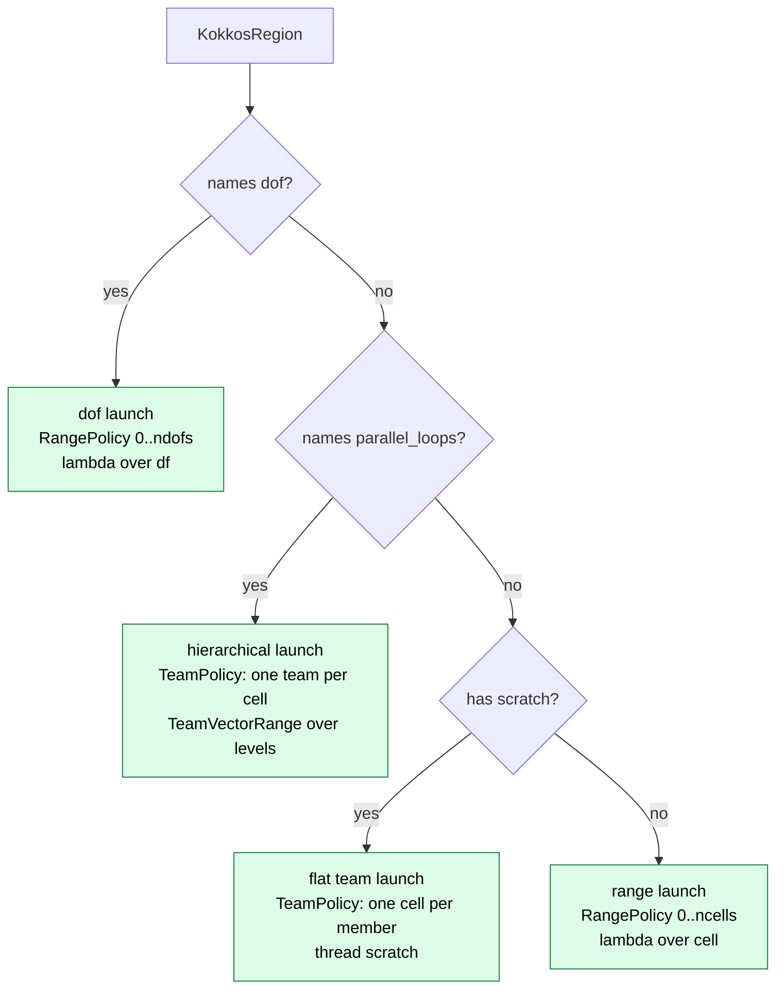

### Fortran/LFRic concept to Kokkos construct

| Source concept | Generated Kokkos |
|----------------|------------------|
| Cell-column loop | `Kokkos::RangePolicy<>(0, ncells)` with `KOKKOS_LAMBDA(const int cell)` |
| Loop over `dof` / `owned_dof` | `RangePolicy` over the dof count, no dofmap, no cell index |
| Loop over halo cells | Launch begins at `cell_start`, a second scalar crossing the ABI |
| Coloured loop (inner `cells_in_colour`) | One region entry per colour; colour map, colour, number of colours and mesh cell count cross the ABI |
| Level loop that dependence analysis accepts | `TeamPolicy`, `cell = team.league_rank()`, loop becomes `Kokkos::parallel_for(TeamVectorRange(...))` then `team.team_barrier()` |
| Array write outside a spread loop (in a team launch) | `Kokkos::single(Kokkos::PerTeam(team), ...)` plus barrier |
| Automatic local array with a run-time extent | `Kokkos::View` over team scratch (`thread_scratch(0)` or `team_scratch(0)`), sized by `shmem_size` |
| Small, team-uniform, fixed-size local array | `KokkosMemberLocal<T, N0, ...>`, a per-member struct (no scratch, no barrier) |
| Scalar written inside a spread loop | Declared inside the loop's lambda if it is loop-private; the region is refused if it is live afterwards |
| Write to a dof two cells share (`gh_inc`, continuous `gh_write`) | `Kokkos::atomic_add` / `_sub` / `_mul` / `_div` / `atomic_store`, or colouring |
| Local `POINTER` aliasing whole arrays | A `Kokkos::View` handle in `Kokkos::AnonymousSpace`, or a `subview` for a contiguous rank-1 section |
| Array argument | Unmanaged `LayoutLeft` View over the caller's pointer; `ReadOnly` (`Unmanaged \| RandomAccess`) when read-only |

The user guide says the choice between atomics and colouring is not a
ranking: it states that which is faster is a measurement on a GPU that "has
not been taken here", and that the two differ in floating-point summation
order (atomic order varies between runs on several threads, coloured order is
fixed).

## 6. Data movement between memory spaces (question 3)

### Headline

- **There is no PSyIR-level data-movement transformation on this branch.**
  Nothing like `ACCEnterDataTrans` or `ACCUpdateTrans` was added or changed
  (no `acc_*` file is in the diff). Data movement is done at **run time**,
  inside the generated C++ region, by a C++ header the back-end writes out.
- **CPU to GPU is handled. GPU to GPU is not.** I found no peer-to-peer copy,
  NCCL, GPU-aware MPI, device selection or multi-device code anywhere in the
  branch's diff.
- Inter-rank movement stays as LFRic's host-side halo exchange. The
  transformation lowers each `LFRicHaloExchange` in front of the region call
  (`_lower_halo_exchanges`), and the user guide states that "Nothing is
  exchanged inside a region".

### How a region gets its data

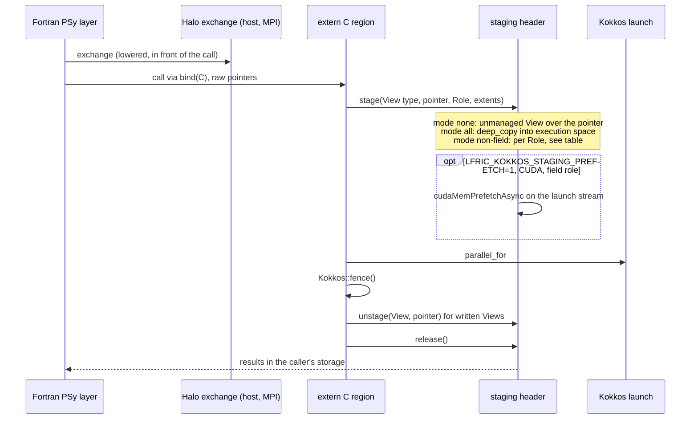

### The staging header

Written by `psyir/backend/kokkos_staging.py` (three statement writers) with
the C++ text in `kokkos_staging_header.py` (about 940 lines, "seven hundred
lines of C++" in the dev guide). It is the only place data crosses memory
spaces. Its mode is read once from the environment at the first region entry:

| Setting | Meaning |
|---------|---------|
| `LFRIC_KOKKOS_STAGING=none` (default) | Unmanaged View over the caller's pointer. No copying. Identical to what the back-end generated before staging existed. |
| `LFRIC_KOKKOS_STAGING=all` | Allocate in the execution space, `deep_copy` in on entry, copy written Views back out. A correctness mode: the header warns on stderr that timings in it are meaningless. |
| `LFRIC_KOKKOS_STAGING=non-field` | Mirror only what needs it, according to the role below. |
| `LFRIC_KOKKOS_STAGING_CACHE=0` | Copy on every call instead of consulting the mirror cache. |
| `LFRIC_KOKKOS_STAGING_POOL=0`, `_POOL_MB=N` | Turn off the buffer pool, or bound what it may hold unused (default 256 MB). |
| `LFRIC_KOKKOS_STAGING_PREFETCH=1`, `_STRIDE=N`, `_DEDUPE=1` | Enable page prefetch, limit it to one in every N stagings, and drop repeats within one call. |

An unrecognised mode value aborts rather than falling back to `none`, so a
misspelt mode cannot be reported as a run in the mode it names.

### Roles (set by `LFRicKokkosTrans`, not by the writer)

The role says *where the storage lives and how long a copy stays good*, not
what one kernel does with it:

| Role | Assigned to | `non-field` behaviour |
|------|-------------|-----------------------|
| `field` | Fields, field vectors, **LMA operators' local stencils** | Left unmanaged over the pointer. LFRic's `lfric_core` is stated to claim these from `SharedSpace`, so the device can reach them. |
| `readonly` | Dofmaps, stencil maps and sizes, colour maps, inter-grid cell maps, reference-element arrays, module arrays | Device mirror cached by `(pointer, bytes)`; copied once. |
| `readwrite` | Columnwise operators, caller-supplied scratch | Staged in and out on every call. |
| `transient` | Basis and differential-basis arrays, quadrature weights | Read-only traits but copied afresh each call, because the PSy layer reallocates these per invoke and an address can be reused for different contents. |

Two design points are documented as hard-won:

- An LMA operator takes the `field` role **even where a kernel only reads
  it**, because an operator is assembled by one kernel and applied by another.
  Read off the access it would look cacheable, and the docs say the whole
  model's solver then stops converging in `non-field` mode while every unit
  test still passes.
- `unstage()` copies out *before* touching the block's reference count. The
  docs describe a bug where a field passed as both a written and a read
  argument had its device write discarded (reported there as 48 suppressed
  copies-out per `C16_MG` step in `all` mode).

### Reducing the cost of movement

- **Buffer pool.** Released staging buffers go on a free list keyed by exact
  byte count (one list per memory space) and are reused. The dev guide says
  about nine in ten allocations on the gungho C48 configuration were storage
  just released, and that `cudaFree` synchronises the driver.
- **Prefetch.** On CUDA, a `field` role lives in managed memory whose pages
  are wherever they were last touched. `cudaMemPrefetchAsync` asks for the
  whole range on the launch's stream instead of 64 KB page faults. It is off
  by default because "the gain is a measurement and not an argument".
- **Prefetch safety.** The length is clamped to the allocation's real end
  (`cuMemGetAddressRange`, reached through `cudaGetDriverEntryPointByVersion`
  so regions need not link `libcuda`), since a View is `undf` long but LFRic
  allocates only out to the field's own halo depth. Every staging ends in
  exactly one of `prefetches`, `prefetch_refused`, `prefetch_skipped`,
  `prefetch_deduped`.
- **Run report.** At `Kokkos::finalize` the header prints, on stderr, totals,
  one line per role (`copies_in`, `copies_out`, `bytes_in`, `bytes_out`,
  `allocs`, `frees`, `reuses`) and a pool line.

### Memory-space handling elsewhere

- `Kokkos::AnonymousSpace` is used for the View handles that stand in for
  Fortran pointers, because it is assignable from and to every memory space.
- Every region ends with `Kokkos::fence()`, so each launch is complete before
  Fortran resumes and the staging epilogue runs.
- Scratch (`ScratchSpace`) is a separate, per-launch memory level covered
  under Q4 and Q6, not cross-space data movement.

## 7. NVIDIA-specific optimisations (question 4)

**MPS: no.** There is no mention of NVIDIA MPS (the Multi-Process Service)
anywhere in the branch's diff, in source, tests or docs. MPS is normally a
run-time deployment setting (a daemon the job launcher starts so several
ranks share one GPU) rather than something a code generator emits, so its
absence from a generator is unsurprising. This is general knowledge, not
something I checked in this repository.

There **is** a good deal of CUDA-specific handling. Most of it is guarded by
`KOKKOS_ENABLE_CUDA` / `KOKKOS_ENABLE_HIP` so a host build is unchanged, and
some is workarounds for specific `nvcc` defects, not optimisations.

```mermaid
flowchart TD
    N["NVIDIA / CUDA specific"] --> O["Optimisations"]
    N --> W["Workarounds for nvcc defects"]
    N --> D["Driver API use"]

    O --> O1["Warp-rounded team size<br/>32 CUDA, 64 HIP"]
    O --> O2["Scratch level chosen at run time<br/>shared memory vs global"]
    O --> O3["Two literal-level launches so nvcc<br/>emits ld.shared"]
    O --> O4["Prefetch managed pages"]
    O --> O5["Pool avoids cudaFree sync"]

    W --> W1["Alias targets forced to level-1 scratch<br/>cvta.to.shared bug, nvcc 13.3"]
    W --> W2["Member-local arrays<br/>miscompile above -Xcicc -O1"]
    W --> W3["Probe functor, no lambda in lambda<br/>extended-lambda refusal"]
    W --> W4["EPSILON passed by reference<br/>odr-use from device code"]

    D --> D1["cudaMemPrefetchAsync"]
    D --> D2["cudaPointerGetAttributes<br/>managed-memory check"]
    D --> D3["cuMemGetAddressRange via<br/>cudaGetDriverEntryPointByVersion"]
    D --> D4["Kokkos::Cuda cuda_stream"]
```

### Optimisations

| What | Where | Detail |
|------|-------|--------|
| **Warp-sized teams** | `computed_team_size` in `kokkos_launch.py`, `kokkos_spread_extent.py` | Team size is the largest spread loop's extent rounded **up** to a warp (32 on CUDA, 64 on HIP) and clamped to `team_size_max`. Host builds keep `Kokkos::AUTO`. See Q6. |
| **Shared-memory vs global scratch, decided at run time** | `scratch_placement` in `kokkos_launch.py` | See the decision diagram below. |
| **Generate the launch twice, one per scratch level** | `scratch_level_dispatch` | `nvcc` emits shared-memory loads only where it can prove a pointer is into shared memory. A run-time level defeated that proof. The docs report `ffsl_flux_xy_special_edge` going from 833 shared loads to 2 with a run-time level. |
| **Managed-memory prefetch** | staging header | Q3. |
| **Staging buffer pool** | staging header | Avoids `cudaFree`'s synchronisation. Allocation alignment note: `CudaSpace` goes through `cudaMalloc` (256-byte aligned), `HostSpace` aligns to 64. |

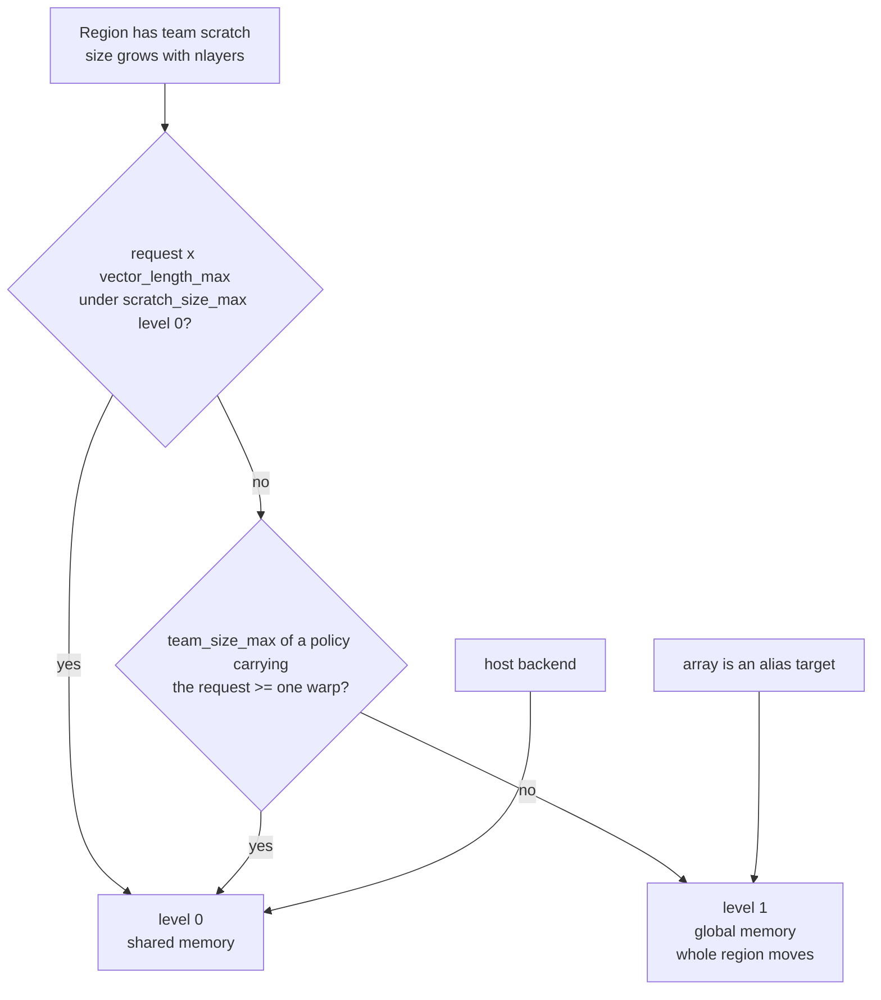

The 48 KiB figure in the docs is the default per-block limit Kokkos 4.7
checks launches against (H100), not an opt-in to a larger carve-out. The docs
say 30 levels fits in every region and 85 levels asks for over 100 KiB a team
in the horizontal FFSL flux regions.

### Workarounds that are specific to `nvcc`

These are recorded in the docs as responses to observed compiler behaviour,
including dated bug reproductions. They keep code correct rather than fast:

- **Alias targets in level-1 scratch.** A View handle aimed at shared memory
  in one branch and global memory in another makes `nvcc` 13.3 infer "shared"
  for the merged pointer (`cvta.to.shared`, `ld.shared`) and the kernel
  faults. Moving every target to global memory makes the pointer generic.
  Recorded against `ffsl_flux_z_nirvana`, 2026-09-14.
- **Member-local arrays.** Team-uniform small arrays held in team scratch were
  miscompiled by `nvcc` 13.3 at any optimisation above `-Xcicc -O1`. Holding
  one per member removes the problem and also drops barriers (8 of 238 in
  `ffsl_flux_xy_panel_remap`).
- **No lambda inside a lambda or a generic lambda.** `nvcc` refuses extended
  lambdas there, so `KokkosScratchProbe` is a separate functor and the launch
  text is duplicated rather than templated.
- **`EPSILON` as a Kokkos trait** so device code can pass it by reference; `std::max`
  extents rely on `--expt-relaxed-constexpr`; a file-scope constant "stops the
  CUDA build", so constants are carried differently.

The dev guide also mentions a CUDA gate in a separate `psy-ir-aidev` tool that
is not part of this branch.

## 8. Number of levels and in-cell data layout (question 6)

### Number of levels (`nlayers`)

This is the most heavily tuned axis on the branch. The central design choice
is: **one team per cell, with the team's members spread over that cell's
levels.**

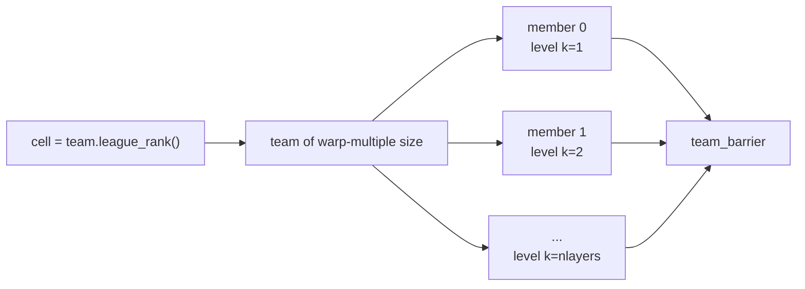

The effects of the level count on generated code:

| Effect | How the branch handles it |
|--------|----------------------------|
| **Which loops are spread** | `LFRicKokkosTrans._parallel_loops` picks the outermost loop dependence analysis accepts, minus stepped loops, loops with an `EXIT`, and **short constant-trip loops** (below `SPREAD_MIN_TRIPS`). A spread over the 3 components of a vector would use 3 members of a warp, put arrays into scratch and turn writes into `single` plus barrier. |
| **Team size** | The largest spread extent, rounded up to a warp, clamped to `team_size_max`. The docs' example: `Kokkos::AUTO` on CUDA is 128 members for a column of 30 levels, leaving 98 idle and all 128 meeting at every barrier. They report the horizontal FFSL flux region going from 22.6 ms to 12.1 ms per launch on an H100 with a team of 32 (a doc claim, not reproduced). Only the extent's *value* is used, and a bound the generated function cannot evaluate contributes nothing, which costs width and not correctness. |
| **Scratch size** | Scratch arrays are column arrays that grow with `nlayers`, so a request that fits at 30 levels does not at 85. The level is chosen at run time (Q4). |
| **Extent expressions** | An array extent can be an integer expression over named sizes: `nlayers`, `nlayers+1`, `(stencil_size+1)/2`. Division is carried with a `Kokkos::abort` guard on negative results. A call such as `max(nlayers, 1)` is refused. |
| **Callee locals sized by `nlayers`** | `LFRicKokkosBoundMixin._bound_locals` sizes a callee's locals from a caller-asserted bound, so inlined helpers get the caller's `nlayers` (for example `subgrid_quadratic_recon`'s eleven locals). |
| **Operator cell slice** | LFRic kernels find their slice of an operator arithmetically, `ik = (cell - 1) * nlayers + 1`. The region declares `cell` from the launch index (`cell_position`) instead of taking it across the ABI, because the PSy layer has nothing correct to pass. |

### In-cell data layout and alignment

What the branch does:

- **All Views are `LayoutLeft`.** The docs justify the team shape by this:
  a cell's levels are the inner dimension of every field it reads, so
  neighbouring members read neighbouring elements, not columns a stride
  apart. A contiguous slice is a `subview`; a non-contiguous one is a copy,
  with a comment in the generated source naming the dimension that broke
  contiguity.
- **`LayoutLeft` strides must be exact.** The colour map's first extent *is*
  its stride, so the number of colours crosses the ABI even though it looks
  redundant. The staging docs record a coloured region that read past the end
  of a copy and stopped with `cudaErrorIllegalAddress` until the mesh cell
  count was passed as well.
- **Member-local arrays** (`KokkosMemberLocal`) are ordered "as `LayoutLeft`
  ordered the View's" elements, flat inside a struct.
- **Buffer alignment** is delegated to Kokkos: pool buffers are keyed by exact
  byte count and not by element type because Kokkos allocations are aligned to
  at least any scalar's alignment in every space (the header cites 256 bytes
  for `CudaSpace`, 64 for `HostSpace`).

What I did **not** find:

- No explicit padding, `alignas`, aligned/over-aligned allocation, or
  `LayoutStride`/`LayoutRight` use. In the transformation sources, `alignas`
  appears only in the list of reserved C++ words that are refused as
  identifiers.
- No data-layout transformation of the LFRic fields themselves (no
  structure-of-arrays or levels-first reordering). The layout is whatever
  LFRic already uses, mapped onto Views.
- No use of `ThreadVectorRange`. Spread loops use `TeamVectorRange`, chosen
  because it spreads over the whole team on a device whatever shape the team
  has. `vector_length_max()` appears only in the scratch-size estimate.

## 9. Other major things the changes do (question 7)

```mermaid
flowchart TD
    M["Other changes"] --> CAP["Capture contract and refusal"]
    M --> IT["Iteration spaces"]
    M --> SW["Shared writes"]
    M --> KE["Kernel features accepted"]
    M --> PY["PSyIR and LFRic infrastructure"]
    M --> RT["Run-time diagnostics"]

    CAP --> CAP1["validate on copies"]
    CAP --> CAP2["TransformationError names the reason"]
    IT --> IT1["cell, coloured, halo, dof, owned_dof"]
    IT --> IT2["built-ins as dof kernels"]
    IT --> IT3["inter-grid"]
    SW --> SW1["atomics"]
    SW --> SW2["colouring"]
    SW --> SW3["disjoint_writes option"]
    KE --> KE1["stencils, quadrature, evaluators"]
    KE --> KE2["LMA operators; CMA refused"]
    KE --> KE3["polymorphic kernels by precision"]
    PY --> PY1["Exit node"]
    PY --> PY2["argument_matching out of Call"]
    PY --> PY3["cell_next mesh property"]
    RT --> RT1["is_initialized guard"]
    RT --> RT2["staging report at finalize"]
    RT --> RT3["negative-extent abort"]
```

- **A published capture contract.** `LFRicKokkosTrans` recognises "a kernel
  shape rather than a named kernel" and refuses everything outside its
  contract with a named reason. `validate()` predicts `apply()` by running it
  on copies. The contract is in the user guide (`lfric-kokkos-capture-contract`).
- **More iteration spaces.** Cell columns, coloured loops, halo-cell loops
  (`cell_start`), `dof` / `owned_dof` loops, LFRic built-ins captured as dof
  kernels, and inter-grid kernels. A loop whose *lower* bound is shifted into
  the halo (`halo_cell_column`) is still refused.
- **Shared-write safety.** Atomics by default, colouring if the loop was
  already coloured, and a `disjoint_writes` assertion for the caller who knows
  better. A body that reads a shared field outside its own read-modify-write is
  refused, a rule added after the docs report a race in the face-selector kernel
  that picked the same FFSL flux face for neighbouring cells on a device.
- **More kernel features on the ABI.** Stencils (per-cell extents, cross2d,
  region), quadrature and evaluator arguments, face quadrature, LMA operators
  (CMA is refused), integer fields, single precision, and **polymorphic
  kernels**, where a generic interface is resolved to the one specific
  procedure the precision map selects.
- **LFRic and PSyIR infrastructure.**
  - `Exit` node and `ProfileTrans` refusing regions that contain one (Part 1).
  - `psyir/nodes/argument_matching.py` (+571) factors argument matching out of
    `Call` (`call.py` +192/-), also used to pick polymorphic specifics.
  - A new LFRic mesh property, `cell_next`: the ids of the cells across each
    face of the current cell.
  - "Complete the PSy-layer symbols a later transformation makes necessary":
    `lfric.py` (+407), `lfric_invoke.py`, `lfric_loop_bounds.py` create the
    PSy-layer names (colour map, number of colours) that a Kokkos region needs
    but standard code generation would not have made.
- **Run-time diagnostics.** A region entered before `Kokkos::initialize()`
  aborts by name (the docs note that otherwise Kokkos runs correctly but
  single-threaded and the omission survives every answer-based test). A
  scratch extent that divides is guarded against a negative result, and the
  staging header prints its report at finalize.
- **Scale of the change.** About +20.3k lines of source and +3.3k lines of
  docs. The rest of the +50.7k is tests and test fixtures (about 27k lines,
  including a 4.7k line `kokkos_test.py`). The docs state that the model captures 272 regions
  and the git log mentions whole-model capture, the wind mapping and
  Held-Suarez forcing. I did not run the capture.

---

## Caveats

- Based on source reading only. Nothing was executed.
- Diffed against **local** `master`. Against `upstream/master`, which has
  moved on, the set of "additions" could differ.
- "Structure manipulating" is my reading of "rewrites the PSyIR tree" (as
  opposed to checking it, or generating text from it). Hoisting, constant
  substitution and bound substitution are borderline. They are included
  because they edit the tree even though they are not classic restructuring
  like inlining or loop fusion.
- **Part 2 caveats.**
  - The "why" in sections 4-9 leans on the branch's own developer and user
    guides. I cross-checked names, files and line counts against the source,
    but I did not verify the guides' behavioural claims by running anything.
    That includes every timing (22.6 to 12.1 ms, 833 to 2 shared loads), every
    count (272 regions, 48 suppressed copies, nine in ten allocations) and
    every `nvcc` bug description.
  - "Not found" claims (no MPS, no GPU-to-GPU movement, no `ACC` changes, no
    explicit alignment or padding) come from searching the full
    `master...origin/feat/kokkos-wind-mapping` diff (about 50.9k added lines)
    for MPS, NCCL, peer access, GPU-aware MPI, device selection and
    `alignas`. A search cannot rule out something named differently, such as
    multi-GPU handling that lives in `lfric_core`, the build system or job
    scripts, none of which are in this repository's diff.
  - Behaviour attributed to `lfric_core` (that it claims field and operator
    storage from `SharedSpace`) is stated in the branch's docs, but `lfric_core`
    is not in this repository, so I could not check it.
  - The Q1 / Q2 split is my own: several mechanisms serve both (for example
    `LayoutLeft` is a translation decision and a Kokkos construct). Each is
    placed where its main purpose lies.
  - The numbering 1-4, 6, 7 matches the questions as asked (there was no 5).
- Method summaries come from docstrings and the code I opened. I read the
  bodies of `_inline_calls`, `_hoist_fold`, `_hoist_array_expressions`,
  `_lower_allocations`, `_substitute_bounds`, `_substitute_constants` and
  `_alias_locals`. For the others I read only the docstring summary.
